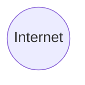

<!-- Template for architecture.md, the readable form of the stage 0 map.
     Translate headings into the user's language. Replace every {{PLACEHOLDER}}. -->

# Architecture: {{SCOPE_NAME}}

Run `{{RUN_ID}}` · scope: {{SCOPE_KIND}} · mapped on {{DATE}}

## Scope

**In:** {{INCLUDES}}

**Out:** {{EXCLUDES}}

## Diagram

## What is in scope

| Kind | Name | Domain | Environment | Based on | Internet-facing | Crown jewel |
|---|---|---|---|---|---|---|
| {{KIND}} | {{NAME}} | {{DOMAIN}} | {{ENVIRONMENT}} | {{ENVIRONMENT_BASIS}} | {{YES_NO}} | {{YES_NO}} |

## Identities and credentials

| Identity | Type | Authenticates with | Credential age | Where the credential lives |
|---|---|---|---|---|
| {{IDENTITY}} | {{TYPE}} | {{CREDENTIAL_TYPE}} | {{AGE}} | {{LOCATION}} |

No secret values in this table: type, age, location and fingerprint only.

## Crown jewels

| Asset | Why it matters | Who can reach it, as far as stage 0 shows |
|---|---|---|
| {{ASSET}} | {{WHY}} | {{WHO}} |

## Log sources

| Source | On for | Sent to | Alerts from it |
|---|---|---|---|
| {{SOURCE}} | {{COVERAGE}} | {{DESTINATION}} | {{YES_NO_UNKNOWN}} |

## Coverage

| Part of the architecture | Seen | Why not, and what would show it |
|---|---|---|
| {{PART}} | {{SEEN_PARTLY_NOT}} | {{GAP_AND_FIX}} |

## Domains for the next stages

{{DOMAIN_LIST}}
